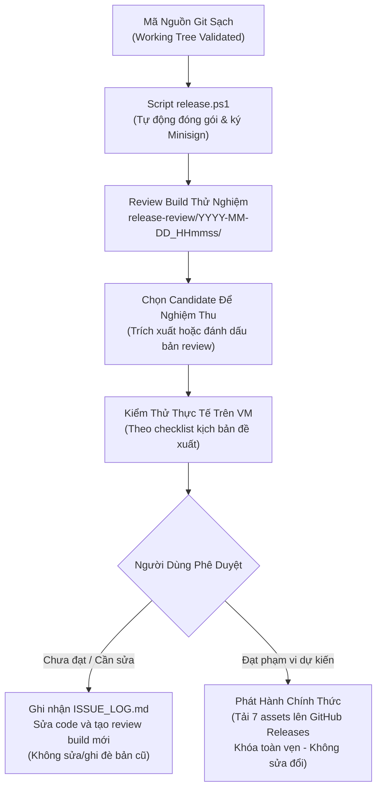

# Oryvia — Quy Ước Phân Loại Mã Nguồn & Vòng Đời Đóng Gói Phát Hành

> **Tài liệu quy chuẩn kỹ thuật:** Quy định rõ ràng ranh giới giữa mã nguồn Git, dữ liệu biên dịch cục bộ, bản dựng kiểm thử review trên máy ảo, ứng viên phát hành (candidate) và gói phân phối chính thức trên GitHub Releases.

---

## 1. Phân Tầng Dữ Liệu Dự Án

| Tầng Dữ Liệu | Đường Dẫn / Định Danh | Quy Tắc Quản Lý Trong Git | Bản Chất & Mục Đích Sử Dụng |
| :--- | :--- | :---: | :--- |
| **1. Source Git** | `src/`, `src-tauri/`, `installer-app/`, `installer/`, `scripts/`, `tests/`, `branding/`, `public/`, `docs/` (ngoại trừ `docs/chat/`), `migration/`, `install_safety.rs`, `taskbar_restore.rs`, lockfiles, configs | **Tracked & Committed** | Toàn bộ mã nguồn, tài nguyên, công cụ đóng gói và hồ sơ cần thiết để xây dựng ứng dụng từ nguồn sạch (lưu ý: việc tái lập binary byte-for-byte phụ thuộc vào môi trường toolchain, thời gian biên dịch và cấu hình build). |
| **2. Generated / Cache Local** | `node_modules/`, `target/` (~14 GB), `dist/`, `gen/`, `payload.zip` | **Ignored Triệt Để** | Dữ liệu nhị phân và cache sinh ra tự động khi cài đặt dependencies hoặc biên dịch ứng dụng; có thể tạo lại khi có kết nối mạng và bộ công cụ phát triển cần thiết (Node/Bun, Rust stable toolchain, Cargo, Tauri CLI v2). |
| **3. Review Builds** | `release-review/<timestamp>/` | **Ignored Triệt Để** | Các bản dựng thử nghiệm cục bộ sinh ra bởi `scripts/release.ps1` để chuyển giao sang máy ảo Windows VM kiểm thử. Có thể ở trạng thái PASS, FAIL hoặc chưa nghiệm thu. |
| **4. Release Candidate** | `release-candidate/<version>-<build-id>/` | **Ignored Triệt Để** | Bộ artifact được trích xuất hoặc đánh dấu từ một đợt review thành công để chuyển vào môi trường kiểm thử nghiệm thu (VM) hoặc bản đã hoàn thành kiểm thử đang chờ người dùng quyết định thời điểm phát hành. |
| **5. GitHub Release Assets** | Tải lên trang GitHub Releases tag `v<version>` | **KHÔNG commit vào Git tree** | Các file nhị phân phân phối chính thức cho người dùng và updater client. |

---

## 2. Quy Chuẩn Vòng Đời Bản Dựng (Build Lifecycle)



### 2.1. Bản Dựng Review (`release-review/<timestamp>/`)
- Được tạo tự động bởi lệnh:
  ```powershell
  ./scripts/release.ps1 -Version "1.0.0"
  ```
- Mỗi thư mục review mang dấu thời gian độc lập (`YYYY-MM-DD_HHmmss`) và chứa đầy đủ 8 thành phần:
  1. `Oryvia-Setup-1.0.0.exe` (Custom Setup UI).
  2. `Oryvia_1.0.0_x64-setup.exe` (NSIS Silent Updater).
  3. `Oryvia_1.0.0_x64-setup.exe.sig` (Chữ ký số Minisign Ed25519).
  4. `oryvia-1.0.0-portable-windows-x64.zip` (Bản portable).
  5. `oryvia-1.0.0-source.zip` (Source archive sạch).
  6. `latest.json` (Updater manifest).
  7. `notes.md` (Ghi chú phát hành).
  8. `SHA256SUMS.txt` (Mã băm SHA-256 xác thực).
- **Lưu ý:** Thư mục review có thể chứa các bản build thất bại (build dở dang do thiếu key, lỗi script) hoặc các bản review trung gian. Việc tồn tại một thư mục trong `release-review/` **không đồng nghĩa** với việc bản build đó đã được nghiệm thu.

### 2.2. Ứng Viên Phát Hành (`release-candidate/<version>-<build-id>/`)
- **Phân định hai trạng thái rõ ràng:**
  1. **Candidate được chọn để nghiệm thu:** Bản dựng review hoàn chỉnh được chọn lọc để đưa vào môi trường máy ảo Windows VM độc lập nhằm kiểm tra thực tế.
  2. **Bản đã nghiệm thu và được phép phát hành:** Bản candidate đã hoàn thành các bước kiểm tra thực tế theo phạm vi mong muốn của người duy trì dự án và được phê duyệt xuất bản.
- **Nguyên tắc xác thực:**
  - **Thao tác đổi tên thư mục đơn thuần không chứng minh được bản build đã được kiểm thử.** Kết quả kiểm tra phải luôn gắn liền với phạm vi kiểm thử cụ thể, số hiệu phiên bản và bảng mã băm SHA-256 đối chiếu của từng file artifact.
  - Tuyệt đối không tự ý tạo hoặc điền các biên bản nghiệm thu giả mạo khi chưa có kết quả kiểm thử thực tế từ người dùng.
- **Checklist & Mẫu biên bản đề xuất (Không phải cổng phê duyệt bắt buộc cứng):**
  - Danh mục 12 kịch bản trong `CHECKLIST_WINDOWS_VM.md` và mẫu biên bản `RELEASE_APPROVAL.json` là **tài liệu đề xuất và hỗ trợ kiểm thử**, giúp người dùng có cơ sở đối chiếu rõ ràng; chúng không phải là điều kiện cổng kỹ thuật tự động ngăn cản quy trình nếu người dùng có kế hoạch kiểm thử theo phạm vi riêng.
- **Minh bạch về lộ trình kiểm thử thực tế:**
  - Người duy trì dự án dự kiến nghiệm thu cục bộ trên máy ảo Windows VM cho phiên bản 1.0.0 (cài đặt per-user/all-users, khởi động cùng Windows, phím tắt, giao diện Dynamic Island/Dock song ngữ, và gỡ cài đặt sạch).
  - Luồng cập nhật trực tuyến N → N+1 (tự động tải và cập nhật từ 1.0.0 lên 1.0.1 qua GitHub Releases) sẽ được kiểm thử thực tế khi phát hành bản 1.0.1.
  - Phần chưa kiểm thử trực tuyến này được công khai minh bạch trong tài liệu phát hành, không tự ý chuyển thành một cổng phê duyệt nhân tạo làm trì hoãn phát hành 1.0.0.

### 2.3. Bộ Phát Hành Phân Phối Chính Thức (GitHub Release Assets)
- Được đính kèm trực tiếp lên phần **Assets** của GitHub Release tại `https://github.com/panchi146/Oryvia/releases/tag/v<version>`.
- **Tuyệt đối không commit các file nhị phân này vào cây mã nguồn Git** nhằm tránh làm phình to dung lượng kho lưu trữ.
- **Minh bạch về chữ ký số:**
  - File cập nhật NSIS `Oryvia_1.0.0_x64-setup.exe` đi kèm chữ ký số **Minisign Ed25519** (`.sig`) phục vụ riêng cho cơ chế xác thực an toàn của `tauri-plugin-updater`.
  - File thực thi Windows **chưa được ký chứng chỉ số doanh nghiệp Microsoft Authenticode** (trạng thái `NotSigned`). Tài liệu phát hành không được gọi nhầm chữ ký Minisign là "Authenticode-signed".

---

## 3. Quy Tắc Bảo Vệ Hồ Sơ Phát Triển & Tính Toàn Vẹn

1. **Phân định Hồ sơ Phát triển & Báo cáo Chat Cục bộ (`docs/chat/`):**
   - Thư mục `docs/chat/` chứa các biên bản làm việc và báo cáo kỹ thuật từng phiên trao đổi với AI, được lưu giữ trên máy cục bộ phục vụ tra cứu cá nhân, **không đưa vào repository công khai hoặc gói source ZIP phân phối (`oryvia-1.0.0-source.zip`)**. Quy định cũ yêu cầu không bao giờ ignore `docs/chat/` đã được bãi bỏ.
   - Toàn bộ tri thức kỹ thuật, phân tích kiến trúc, quy chuẩn vận hành và giải pháp khắc phục sự cố cần duy trì lâu dài **phải được tổng hợp một cách có hệ thống vào các tài liệu chuyên biệt**:
     - Đặc tả kỹ thuật & Hướng dẫn AI: `docs/development/PROJECT_SPEC.md`, `AGENTS.md`.
     - Kiến trúc, nguồn gốc & bản quyền: `docs/architecture/ORYVIA_README.md`, `NOTICE`, `LICENSE`.
     - Sổ tay theo dõi sự cố & bài học kinh nghiệm: `docs/ISSUE_LOG.md`.
     - Tài liệu hướng dẫn cài đặt & cấu hình: `docs/guides/SETTINGS.md`, `docs/readme/README.vi.md`, `README.md`.
   - **Tài liệu công khai không được phụ thuộc duy nhất vào các báo cáo chat bị loại khỏi repo.** Mọi dẫn chiếu phải trỏ tới các tài liệu công khai nêu trên hoặc được tóm tắt đầy đủ ngữ cảnh trực tiếp.
   - **Bảo mật tuyệt đối:** Nghiêm cấm đưa private key, API token, mật khẩu hoặc bất kỳ credential cá nhân nào vào các tài liệu tổng hợp.
   - Sổ tay quản lý sự cố `docs/ISSUE_LOG.md` và các tài liệu kiến trúc tiếp tục được quản lý chặt chẽ trong Git (`Tracked`).
2. **Bảo toàn artifact cũ:**
   - Tuyệt đối không xóa, di chuyển hoặc ghi đè lên các gói review đã ký hoặc các bản phát hành lịch sử.
   - Khi cần điều chỉnh mã nguồn hoặc tài liệu, phải tạo bản build mới với timestamp mới.
3. **Đồng bộ hóa Corresponding Source Archive:**
   - Khi có thay đổi trong mã nguồn, tooling đóng gói hoặc tài liệu hướng dẫn trong working tree, gói `oryvia-<version>-source.zip` và `SHA256SUMS.txt` cần được đóng gói lại tại lần build cuối cùng trước khi chính thức tải lên GitHub Release.
