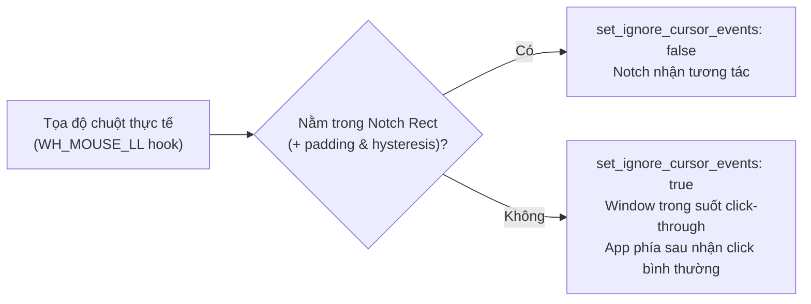

> **Current project: Oryvia, maintained by Panchi146.** The document below is retained from upstream Nectar for historical reference; branding, paths and release links may be outdated. See [Oryvia documentation](../architecture/ORYVIA_README.md) and [NOTICE](../../NOTICE) for the current identity and licensing.

# Nectar — Project Technical Specification & Architecture Manual

> **Phiên bản:** 1.4.3 (Stabilize Dynamic Island Mode Switching)  
> **Mốc commit ổn định:** `Backup 18 - Stabilize Dynamic Island Mode Switching` trên nhánh `shortcuts-redo`  
> **Sổ tay kỹ thuật tra cứu lỗi:** [docs/ISSUE_LOG.md](../ISSUE_LOG.md)  
> **File untracked cần bảo vệ:** `src (2).zip` (giữ nguyên, không can thiệp).

---

## 1. Tổng quan dự án

**Nectar** là ứng dụng desktop chạy trên Windows 10/11, mang trải nghiệm giao diện Dynamic Island (Notch) và Dock hiện đại vào hệ điều hành Windows:
1. **Dynamic Island (Notch):** Thanh tương tác nổi tại mép trên màn hình, tự động biến đổi kích thước theo ngữ cảnh: trạng thái hệ thống, media player, lịch và Control Center (12 quick actions + Shortcuts Bar).
2. **Nectar Dock:** Thanh tác vụ thay thế hoặc bổ sung cho Windows Taskbar với cơ chế AppBar (`SHAppBarMessage`), quản lý cửa sổ đang chạy, ứng dụng ghim, thumbnail preview trực tiếp, per-app volume mixer, và phím tắt `Win + 1..9`.
3. **HUD Overlays:** Giao diện Volume / Brightness cao cấp thay thế OSD mặc định của Windows, kích hoạt qua di chuột mép màn hình (Edge Hover) hoặc cuộn chuột.
4. **Calendar & Productivity:** Lịch đa chế độ (tháng, tuần, ngày, agenda), đồng bộ CalDAV/webcal ICS, đồng hồ đếm ngược (âm báo Web Audio) và bấm giờ có laps.
5. **Kiến trúc Click-Through Windows An Toàn:** Cửa sổ trong suốt `1920x420` không chặn chuột của các ứng dụng Windows bên dưới nhờ kết hợp đồng bộ vùng Notch (`update_notch_rect`) và Windows low-level mouse hook (`WH_MOUSE_LL`).

---

## 2. Công nghệ, Thư viện & Kiến trúc

### 2.1. Frontend
- **Framework:** React 19 (`react` 19.1.0, `react-dom` 19.1.0) + TypeScript 5.8 + Vite 7.0
- **CSS & Animation:** TailwindCSS v4, Framer Motion v12 (spring physics cho morphing layout)
- **Kéo thả:** `@dnd-kit/core`, `@dnd-kit/sortable` (sắp xếp status widgets và dock)
- **Biểu tượng:** `lucide-react` + SVG icons nội bộ (`src/icons/`)
- **Tauri Bindings:** `@tauri-apps/api` v2.11.1, plugin dialog, opener, autostart, drag

### 2.2. Backend & Windows API (Rust)
- **Framework:** Tauri v2.11, Rust 2021 Edition
- **Windows API (`windows` crate 0.61):**
  - Cửa sổ & Input: HWND management, `SetWindowPos`, `SetWindowLongPtrW`, `WH_MOUSE_LL`, `WH_KEYBOARD_LL`
  - Shell & Taskbar: `SHAppBarMessage` (`ABM_NEW`, `ABM_REMOVE`, `ABM_SETPOS`)
  - Đồ họa & DWM: `DwmRegisterThumbnail` để chụp thumbnail cửa sổ thời gian thực
  - Âm thanh & Media: Windows SMTC (System Media Transport Controls), WASAPI Endpoint Volume, Audio Session Manager
  - Phần cứng & Mạng: `Devices_Radios` (Bluetooth), `Win32_NetworkManagement_WiFi`, `System_Power` (pin vật lý), `wmi`, ToolHelp32 (CPU, RAM, Disk, Net speed, Processes)
- **Vibrancy & Bảo mật:** `window-vibrancy` (Acrylic), `keyring` (lưu mật khẩu CalDAV và link ICS an toàn trong Windows Credential Manager)

### 2.3. Cửa sổ Webview
1. `main` (`index.html` -> `src/App.tsx`): Dynamic Island Notch (`1920x420`, transparent, alwaysOnTop, frameless, skipTaskbar).
2. `dock` (`dock.html` -> `src/Dock.tsx`): Nectar Dock (`1920x600`, transparent, alwaysOnTop, frameless, skipTaskbar).
3. `settings` (`settings.html` -> `src/Settings.tsx`): Cửa sổ cài đặt (`620x480`, Acrylic, resizable).
4. `calendar` (`calendar.html` -> `src/Calendar.tsx`): Cửa sổ lịch đầy đủ (`880x600`, Acrylic, resizable).
5. `overlay` (`overlay.html` -> `src/Overlay.tsx`): HUD Volume/Brightness (`1920x1080`, transparent, alwaysOnTop).

---

## 3. Phân loại Tính năng & Hiện trạng Mã nguồn

```
┌──────────────────────────────────────────────────────────────────────────────┐
│                            PHÂN LOẠI TÍNH NĂNG                               │
├──────────────────────────────┬───────────────────────────────────────────────┤
│ 1. Tính năng đang hoạt động  │ - 4 modes Dynamic Island (status, music,     │
│                              │   calendar, command-center)                   │
│                              │ - Shortcuts Bar: kéo thả, ghim, icon native   │
│                              │ - 12 quick action buttons trong Control Center│
│                              │ - Dock: pinned apps, taskbar replacement      │
│                              │ - Click-through qua update_notch_rect & hook  │
│                              │ - i18n zero-IPC (useSyncExternalStore) EN/VI  │
│                              │ - Soft Light Glass & Ambient Glow             │
│                              │ - HUD Overlays với Edge Hover & Wheel         │
├──────────────────────────────┼───────────────────────────────────────────────┤
│ 2. Lỗi đã sửa trong các mốc  │ - Backup 01: Sửa tọa độ chuột HUD Overlay     │
│    commit Backup (01 -> 18)  │ - Backup 02: Cuộn chuột Volume Mixer          │
│                              │ - Backup 04-05: Shortcuts hover, smooth scroll│
│                              │ - Backup 06: Control Center 12 nút & mouse fix│
│                              │ - Backup 07: Sửa Dropdown tràn khung bằng     │
│                              │   usePopoverPosition portal                   │
│                              │ - Backup 10: Sửa kéo thả Status Widget        │
│                              │ - Backup 11: Sửa lag CPU qua i18n zero-IPC    │
│                              │ - Backup 13: Thêm Soft Bounce khi hover       │
│                              │ - Backup 14: Tách con lăn chuột trong lịch    │
│                              │ - Backup 15: Fix UI overlap & stuck blur      │
│                              │ - Backup 16: Fix compact ambient glow         │
│                              │ - Backup 17: Bổ sung tài liệu & AI Rules      │
│                              │ - Backup 18: Khắc phục kẹt mode Music qua     │
│                              │   Direct Outer Branching (bỏ AnimatePresence  │
│                              │   mode="wait" ngoài); bọc Compact Glow Wrapper│
│                              │   triệt tiêu khe trắng ngang mép trên; tích   │
│                              │   hợp bộ đo kiểm snapshot DEV an toàn.        │
├──────────────────────────────┼───────────────────────────────────────────────┤
│ 3. Vấn đề đang theo dõi &    │ - Chuyển đổi tầng trong (Shortcuts / Calendar │
│    Hạn chế kỹ thuật          │   / Command Center): trạng thái Monitoring    │
│                              │   (không còn tái hiện gần đây khi cuộn nhanh, │
│                              │   nhưng chưa xác nhận sửa triệt để - INC-02). │
│                              │ - Khe trắng tại 2 chỗ nối tai thỏ (Ear Seams) │
│                              │   khi hover trên nền sáng: Open (INC-03).     │
│                              │ - Lịch CalDAV/webcal là Read-Only (chỉ đọc)  │
│                              │ - Widget pin tự ẩn trên máy bàn không có pin  │
│                              │ - Dock AppBar phụ thuộc crash-recovery marker │
├──────────────────────────────┼───────────────────────────────────────────────┤
│ 4. Thí nghiệm đã loại bỏ     │ - SVG góc lõm Dynamic Island (SVG ear corners)│
│    (Không được nhầm lẫn)     │   từng thử nghiệm nhưng thất bại do răng cưa, │
│                              │   lỗi blur và tốn CPU khi co giãn. Bản ổn     │
│                              │   định hiện tại sử dụng CSS/Framer Motion     │
│                              │   border-radius thuần túy!                    │
└──────────────────────────────┴───────────────────────────────────────────────┘
```

---

## 4. Cơ chế Hoạt động của Dynamic Island

### 4.1. 4 Chế độ hiển thị (`nectarMode`)
- `status`: Đồng hồ (12h/24h) và các widget thụ động: `weather`, `battery`, `cpu`, `ram`, `disk`, `net`.
- `music`: Nhận tín hiệu từ Windows SMTC; hiển thị album art, visualizer sóng âm, tên bài hát marquee, ca sĩ, seek bar, play/pause, volume slider, ngõ ra âm thanh.
- `calendar`: Lịch tháng/tuần/ngày, danh sách sự kiện CalDAV/ICS, đếm ngược (timer), bấm giờ (stopwatch).
- `command-center`: 12 nút toggle nhanh (WiFi, Bluetooth, Battery Saver, Theme/Night Light, Volume, Brightness, DND, Screenshot, Task Manager, Clipboard History, Settings, Lock/Sleep) + **Shortcuts Bar**.

### 4.2. Luồng Tương tác Chuột
- **Hover:**
  - Nếu `settingsNotchExpandOnHover = true`: Di chuột vào sẽ mở rộng sau `settingsNotchHoverDelay` (ms).
  - Nếu `settingsNotchExpandOnHover = false`: Đảo giữ kích thước thu gọn và kích hoạt hiệu ứng **Soft Bounce** (`scale: [1, 1.08, 1.05]`).
- **Click:**
  - Nhấp vào đảo khi đang thu gọn: Mở rộng tức thì (`triggerExpand()`).
  - Nhấp vào nút mở app ngoài (`launchExternalQuickAction`): Cưỡng chế thu gọn tức thì (`isForceCompactRef = true`), gửi `update_notch_rect` kích thước thu gọn (`36px`) để giải phóng chuột cho ứng dụng đích.
- **Wheel (Chuyển chế độ):**
  - Cuộn chuột trên đảo sẽ luân chuyển các chế độ: `command-center` ⇄ `music` (nếu đang phát) ⇄ `status` ⇄ `calendar`.
  - **Bảo vệ vùng cuộn nội bộ:** Tuyệt đối không can thiệp nếu sự kiện phát sinh từ `.cal-scroll` hoặc `.shortcuts-scroll-area`.
  - Ngưỡng kích hoạt cuộn (`wheelStepThreshold`): `high` = 30, `normal` = 60, `low` = 100.

### 4.3. Bảo toàn Click-Through Windows

- Frontend gửi tọa độ qua `invoke('update_notch_rect', { rect })`.
- Để tránh nghẽn IPC, chỉ gửi khi chuỗi tọa độ thực sự thay đổi (`key !== lastSent`).

### 4.4. Kiến trúc Phân nhánh Giao diện & Hiệu ứng Chuyển cảnh (View Branching & Animation)
- **Cấu trúc phân tầng hiện tại:**
  1. **Phân nhánh tầng ngoài (Outer Branch):** Sử dụng React conditional rendering trực tiếp `{isHovered && isMusicMode && !isCalendarMode ? (...) : (...)}` để chuyển đổi giữa `expanded-music` và `standard-view-group`.
     - *Kết quả thực nghiệm:* Việc loại bỏ `AnimatePresence mode="wait"` ở tầng phân nhánh ngoài này đã giúp chế độ Music thoát khỏi hiện tượng kẹt view cũ (đã được người dùng kiểm thử xác nhận thành công trên working tree).
  2. **Phân nhánh tầng trong (Inner Branch):** Nằm bên trong `standard-view-group`, sử dụng `AnimatePresence mode="wait"` để luân chuyển giữa các panel con: `shortcuts-row` (status mode), `command-center-panel`, và `calendar-panel`.
     - *Trạng thái:* Vùng tầng trong này **vẫn đang trong quá trình điều tra / tối ưu** và chưa được xác nhận sửa xong.
- **Bài học kỹ thuật phòng ngừa rủi ro:**
  - Hạn chế tối đa việc lồng ghép các `AnimatePresence mode="wait"` nhiều tầng phụ thuộc lẫn nhau, vì khi component cha chuyển đổi trạng thái đột ngột, exit queue của phần tử con có nguy cơ không dọn dẹp kịp thời và gây hiện tượng giữ lại DOM view cũ.
  - Luôn tra cứu [docs/ISSUE_LOG.md](../ISSUE_LOG.md) (mục `INC-02`) trước khi chỉnh sửa bất kỳ logic animation nào của Dynamic Island.

---

## 5. Kiến trúc Settings & Đồng bộ Cấu hình

- **Lưu trữ:** `%APPDATA%\com.kua8.nectar\settings.json`.
- **Cơ chế đồng bộ:**
  1. Thay đổi từ UI: Gửi `save_setting` qua IPC -> Rust cập nhật file và cache -> Phát event `settings-changed` -> `useSettingsSync` cập nhật state của các webview.
  2. Thay đổi từ bên ngoài (VS Code, scripts): Rust watcher (`ReadDirectoryChangesW`) phát event `settings-external-changed` -> `useSettingsSync` cập nhật state và `localStorage`.
- **An toàn:** `useSettingsSync` dùng `useRef` cho handlers, chỉ đăng ký listener một lần duy nhất, tránh memory leak và lag khi re-render.

---

## 6. Hệ thống i18n (Zero-IPC)

- Hỗ trợ Tiếng Anh (`en`) và Tiếng Việt (`vi`) qua từ điển [src/i18n/translations.ts](../../src/i18n/translations.ts).
- Hook [src/i18n/index.ts](../../src/i18n/index.ts) sử dụng React 18 `useSyncExternalStore` với module-level singleton state.
- **Zero-IPC:** Mount/unmount trong 0ms, không gọi Tauri IPC trong luồng đọc ngôn ngữ.
- Đồng bộ giữa các cửa sổ WebView2 tự động qua sự kiện `window.addEventListener("storage", ...)`.

---

## 7. Khu vực Nhạy cảm & Rủi ro Regression

1. **`update_notch_rect` & Mouse Hook (`services.rs`):**
   - Sai lệch kích thước hoặc mất cờ click-through sẽ biến cửa sổ `1920x420` thành tấm kính vô hình chặn chuột toàn bộ ứng dụng Windows bên dưới.
2. **Taskbar Marker & Khôi phục Taskbar (`init_taskbar_marker`, `restore_taskbar_after_crash`):**
   - Đảm bảo Taskbar gốc của Windows luôn được phục hồi khi Nectar tắt hoặc crash. Không được xóa logic này.
3. **Loại trừ cuộn trong `handleWheel` (`App.tsx`):**
   - Luôn duy trì kiểm tra `target.closest('.cal-scroll')` và `target.closest('.shortcuts-scroll-area')`.
4. **Không đưa IPC vào Render Path:**
   - Tuyệt đối không gọi `invoke()` trong thân render hoặc effect không có dependency.

---

## 8. Danh mục File Tra Cứu Nhanh

| Chức năng | Đường dẫn file chính |
| :--- | :--- |
| **Dynamic Island (Notch)** | `src/App.tsx`, `src/App.css`, `src/CompactMediaPlayer.tsx`, `src/components/NotchClock.tsx` |
| **Shortcuts Bar** | `src/components/ShortcutsBar.tsx`, `src/components/ShortcutsBar.css` |
| **Status Widgets Drag** | `src/components/StatusWidgetConfig.tsx` |
| **Lịch & Hẹn giờ** | `src/Calendar.tsx`, `src/components/NotchCalendar.tsx`, `src/hooks/useCaldav.ts`, `src-tauri/src/caldav.rs`, `src-tauri/src/ics.rs` |
| **Nectar Dock** | `src/Dock.tsx`, `src/Dock.css`, `src-tauri/src/taskbar_pins.rs`, `src-tauri/src/services.rs` |
| **Cài đặt & Đồng bộ** | `src/Settings.tsx`, `src/settings/*`, `src/hooks/useSettingsSync.ts` |
| **Đa ngôn ngữ** | `src/i18n/index.ts`, `src/i18n/translations.ts` |
| **Giao diện & Theme** | `src/theme.ts`, `src/settings/AppearanceTab.tsx` |
| **Overlays** | `src/Overlay.tsx`, `src/Overlay.css`, `src/settings/OverlaysTab.tsx` |
| **Mouse Hook & IPC** | `src-tauri/src/services.rs`, `src-tauri/src/commands.rs`, `src-tauri/src/main.rs` |
