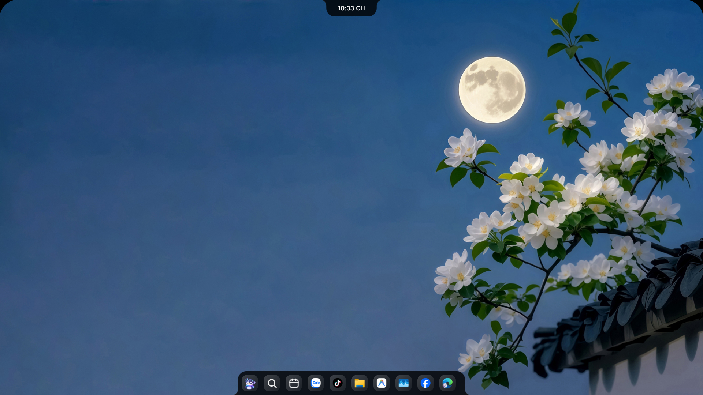
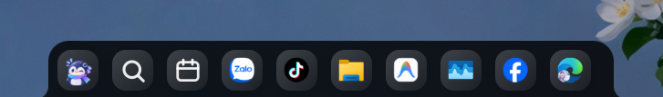

<div align="center">


<br />

# Oryvia

**Dynamic Island (Notch) và Dock vật lý tương tác hiện đại dành cho Windows: mượt mà, phản hồi tức thì và sẵn sàng thay thế thanh taskbar của bạn.**

<br />

<p>
  <a href="../../README.md">English</a> &nbsp;·&nbsp; <strong>Tiếng Việt</strong>
</p>

[](../../LICENSE)

[](https://github.com/panchi146/Oryvia/releases)

[**Tải về**](https://github.com/panchi146/Oryvia/releases) &nbsp;·&nbsp; [Tính năng](#tính-năng) &nbsp;·&nbsp; [Dynamic Island](#dynamic-island-the-notch) &nbsp;·&nbsp; [Thanh Dock](#thanh-dock-the-dock) &nbsp;·&nbsp; [Đa màn hình](#đa-màn-hình) &nbsp;·&nbsp; [Cài đặt](../guides/SETTINGS.md) &nbsp;·&nbsp; [Biên dịch từ nguồn](#biên-dịch-từ-mã-nguồn)

<br />



</div>

<br />

Oryvia là một bản fork từ [Nectar](https://github.com/kua8/Nectar) của kua8 và các cộng tác viên, vốn được fork từ [Bloom](https://github.com/SehajveerSingh2005/bloom) của Sehajveer Singh; ý tưởng và mã nguồn nền tảng ban đầu thuộc về họ. Oryvia được duy trì độc lập bởi **Panchi146**, với các cải tiến riêng, hỗ trợ song ngữ (Tiếng Việt / English), cơ chế cài đặt có giao dịch rollback an toàn và định hướng phát triển riêng.

## Tính năng

- **Một chiếc Notch làm được mọi việc.** Âm nhạc, điều khiển nhanh, thông số phần cứng và lịch làm việc tích hợp trong một Dynamic Island chuyển động lò xo vật lý ở mép trên màn hình.
- **Thanh Dock thay thế taskbar của bạn.** Tự động đồng bộ các ứng dụng ghim từ taskbar thật của Windows (đúng thứ tự, đúng icon và tên thật) và ẩn thanh taskbar mặc định đi.
- **Gốc và chuẩn xác từng chi tiết.** Nút khay hệ thống mở ra đúng menu icon ẩn của Windows, và nút "Thoát" tắt hẳn ứng dụng y như End Task trong Task Manager.
- **Tùy biến theo ý bạn.** Các chủ đề giao diện, 3 chế độ hiển thị, vị trí trên từng màn hình, và mọi tùy chọn đều nằm trong file `settings.json` chỉnh sửa tức thì.
- **Rất nhẹ cho hệ thống.** Tự động tạm dừng thu nhận âm thanh, theo dõi chuột và render thumbnail khi không có tương tác nào cần đến.

## Dynamic Island (The Notch)

Một chiếc notch tại mép trên màn hình tự động thích ứng với tác vụ bạn đang làm. Cuộn chuột hoặc vuốt để chuyển chế độ, hoặc ghim cố định như một notch phần cứng.

<div align="center">

</div>

<br />

| Chế độ | Chức năng chi tiết |
| --- | --- |
| **Âm nhạc (Music)** | Ảnh bìa album, thông tin bài hát, nút điều khiển phát nhạc và hiệu ứng sóng âm phản hồi 5 dải tần số. |
| **Trung tâm điều khiển (Command Center)** | Wi-Fi, Bluetooth, Không làm phiền, âm lượng và độ sáng màn hình không cần mở Windows Settings, kèm thanh Shortcuts ghim ứng dụng. |
| **Trạng thái (Status)** | Chỉ báo pin (tự ẩn trên máy tính bàn cắm điện) và thời tiết, thông số phần cứng theo bố cục bạn chọn. |
| **Lịch (Calendar)** | Lịch tháng tích hợp đồng hồ đếm ngược Pomodoro tập trung và đồng hồ bấm giờ có ghi vòng (laps). |

Chiều rộng, chiều cao, bo góc và vị trí đều chuyển động trên spring physics riêng, tạo cảm giác mượt mà và tự nhiên.

**Các chế độ hiển thị** (Cài đặt › Notch):

| Chế độ | Hành vi |
| --- | --- |
| **Cố định (Fixed)** | Luôn luôn hiển thị, kể cả khi chạy ứng dụng toàn màn hình, giống như một notch phần cứng. |
| **Thông minh (Smart)** | Tự động ẩn đi khi có cửa sổ ứng dụng khác đè lên và hiện lại khi bạn rê chuột vào. |
| **Thu gọn (Peek)** | Ẩn hoàn toàn cho đến khi con trỏ chuột chạm mép trên màn hình, hoặc khi có thông báo đa phương tiện. |

Ở chế độ Smart và Peek, notch tương tác chuột đầy đủ khi được mở ra. Toàn bộ vùng trong suốt duy trì click-through an toàn, không bao giờ chặn hay chiếm chuột của các phần mềm khác bên dưới. Notch không chiếm desktop space cố định nên không để lại khoảng trống khi phóng to ứng dụng.

## Thanh Dock (The Dock)

Một thanh tác vụ có thể dịch chuyển linh hoạt. Kéo thả icon để sắp xếp, rê chuột để xem trước cửa sổ, và chuột phải để mở menu thao tác.

<div align="center">

</div>

<br />

- **Đồng bộ thanh taskbar của bạn.** Ngay lần đầu khởi chạy, Oryvia tự động nhập danh sách ứng dụng đã ghim từ taskbar Windows theo đúng thứ tự, bao gồm File Explorer, Discord và các app Microsoft Store.
- **Biểu tượng và tên thật chuẩn xác.** Windows Settings hiển thị biểu tượng bánh răng và Task Manager được gọi đúng là "Task Manager" thay vì `taskmgr`.
- **Tách biệt ứng dụng đang chạy và đã ghim.** Một vạch phân cách chia rõ hai khu vực. Bật **Trộn ứng dụng ghim & đang chạy** để kéo thả tự do.
- **Thoát là thoát hẳn.** Chuột phải › Thoát tắt hẳn tiến trình ứng dụng y như End task trong Task Manager.
- **Tích hợp tìm kiếm.** Icon tìm kiếm bên cạnh Start mở ngay Windows Search.
- **Khay hệ thống gốc.** Nút khay hệ thống mở ra đúng bảng icon ẩn của Windows ngay dưới notch.

Thanh Dock sử dụng cùng 3 chế độ hiển thị **Cố định (Fixed)**, **Thông minh (Smart)**, và **Thu gọn (Peek)** như notch. Chế độ Fixed tạo không gian đáy như taskbar thông thường, Smart ẩn khi cửa sổ đè lên, và Peek ẩn đi cho đến khi bạn đưa chuột xuống mép đáy màn hình.

## Đa màn hình

Cả Dock và Notch đều có cài đặt **Hiển thị trên** riêng biệt trong Cài đặt:

| Tùy chọn | Kết quả |
| --- | --- |
| **Màn hình chính** | Chỉ hiển thị trên màn hình chính của bạn (mặc định). |
| **Tất cả màn hình** | Mỗi màn hình kết nối sẽ hiển thị một bản sao riêng biệt. |
| **Màn hình cụ thể** | Ghim cố định vào một màn hình bạn chọn từ danh sách. |

Vì hai thành phần này độc lập với nhau, giao diện có thể tùy biến linh hoạt theo nhu cầu của bạn:

- **Dock và notch trên mọi màn hình.** Mỗi màn hình đều có giao diện tương tự và Dock tự căn chỉnh không gian đáy.
- **Dock chỉ ở màn hình chính.** Các màn hình phụ không có taskbar nào, vì taskbar Windows đã được ẩn trên tất cả màn hình khi bật Dock. Cửa sổ phóng to ở màn hình phụ sử dụng trọn vẹn toàn bộ diện tích.
- **Notch ở một màn hình, Dock ở một màn hình khác.** Hoạt động mượt mà và mỗi bên theo chế độ hiển thị riêng.
- **Tắt Dock.** Thanh taskbar gốc của Windows sẽ tự động hiện lại trên mọi màn hình.

Các màn hình phụ được tạo cửa sổ riêng, do đó chế độ **Tất cả màn hình** sẽ tốn thêm một chút CPU và RAM so với một màn hình đơn. Nếu máy của bạn có cấu hình thấp, hãy giữ tùy chọn **Hiển thị trên** ở một màn hình.

## Cài đặt

1. Tải về từ trang [Releases chính thức](https://github.com/panchi146/Oryvia/releases):
   - **Bản cài đặt Custom Setup (Khuyến nghị):** `Oryvia-Setup-1.0.0.exe` — giao diện đồ họa hiện đại, chọn cài **Chỉ cho tôi** hoặc **Tất cả người dùng** (hỏi quyền Administrator một lần), có cơ chế giao dịch rollback tự động chống lỗi.
   - **Bản Portable:** `oryvia-1.0.0-portable-windows-x64.zip` — giải nén và chạy ngay `oryvia.exe`, không can thiệp registry hệ thống.
2. Chọn **Chỉ cho tôi** hoặc **Tất cả người dùng**. Bản cài đặt cho tất cả người dùng sẽ yêu cầu quyền Quản trị viên một lần.
3. Oryvia khởi động với hoạt ảnh ngắn, sau đó Notch và Dock sẽ xuất hiện đồng thời.

Oryvia tự động cập nhật: chấm màu xanh trên notch báo hiệu có bản cập nhật mới sẵn sàng, và bạn có thể bật **Tự động cập nhật** trong **Cài đặt › Về Oryvia** (sử dụng Tauri Updater v2 với các gói NSIS đã ký Minisign). Các tệp thực thi review hiện tại chưa đăng ký chứng chỉ thương mại Authenticode (`NotSigned`).

**Gỡ cài đặt** từ Windows Settings › Apps, hoặc từ nút trong **Cài đặt › Về Oryvia**. Cả hai cách đều gỡ sạch ứng dụng, khôi phục thanh taskbar gốc nguyên vẹn và bảo toàn các tệp cấu hình cá nhân.

## Biên dịch từ mã nguồn

Bạn cần cài đặt [Rust](https://rustup.rs/) (v1.77+) và [Bun](https://bun.sh/) (v1.0+).

```bash
git clone https://github.com/panchi146/Oryvia.git
cd Oryvia
bun install
bun run tauri dev
```

Để biên dịch bản release hoàn chỉnh:

```powershell
bun run tauri build --no-bundle
powershell -ExecutionPolicy Bypass -File installer-app/scripts/build-payload.ps1
cd installer-app && bun run tauri build --no-bundle && cd ..
```

Hoặc chạy toàn bộ quy trình đóng gói và ký số: `powershell -ExecutionPolicy Bypass -File scripts/release.ps1`.

## Đóng góp & Báo lỗi

Bạn phát hiện lỗi hoặc có ý tưởng mới? Hãy [Mở một issue](https://github.com/panchi146/Oryvia/issues) hoặc gửi pull request. Vui lòng nêu rõ phiên bản Windows và số lượng màn hình nếu bạn gặp lỗi liên quan đến hiển thị. Đối với báo cáo lỗ hổng bảo mật, vui lòng tham khảo [Chính sách bảo mật](../../SECURITY.md).

## Giấy phép & Ghi công

Oryvia là phần mềm mã nguồn mở phát hành theo giấy phép [GPLv3](../../LICENSE) (GPL-3.0-only).

- **Bloom:** Ý tưởng nguyên bản và mã nguồn nền tảng ban đầu do [Sehajveer Singh (`sehaz`)](https://github.com/SehajveerSingh2005/bloom) phát triển (Bản quyền gốc: *Copyright © 2026 Sehajveer Singh*).
- **Nectar:** Bản fork mở rộng với Lịch, đa màn hình và Custom Installer do [kua8 cùng các cộng tác viên](https://github.com/kua8/Nectar) phát triển.
- **Oryvia:** Dự án hiện tại do [Panchi146](https://github.com/panchi146) duy trì với hỗ trợ song ngữ Tiếng Việt/English, củng cố an toàn rollback khi cài đặt và kênh cập nhật Tauri v2.

Xem [NOTICE](../../NOTICE) để biết đầy đủ hồ sơ nguồn gốc pháp lý.
